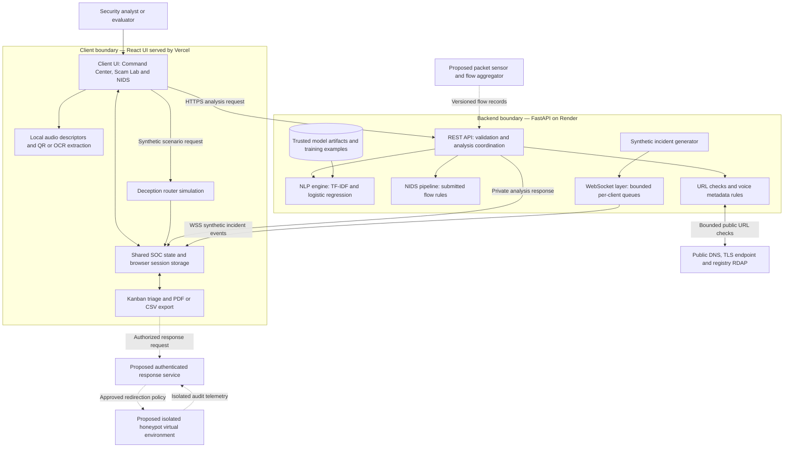
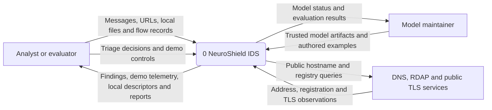
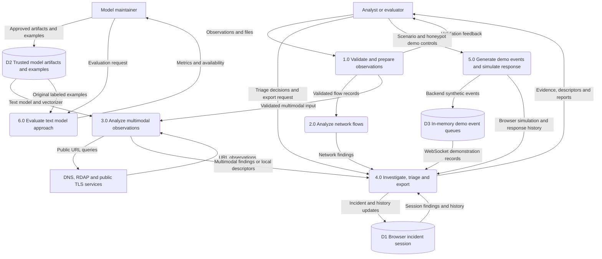
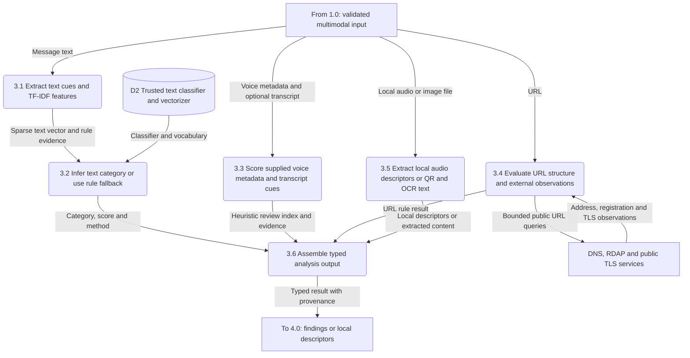
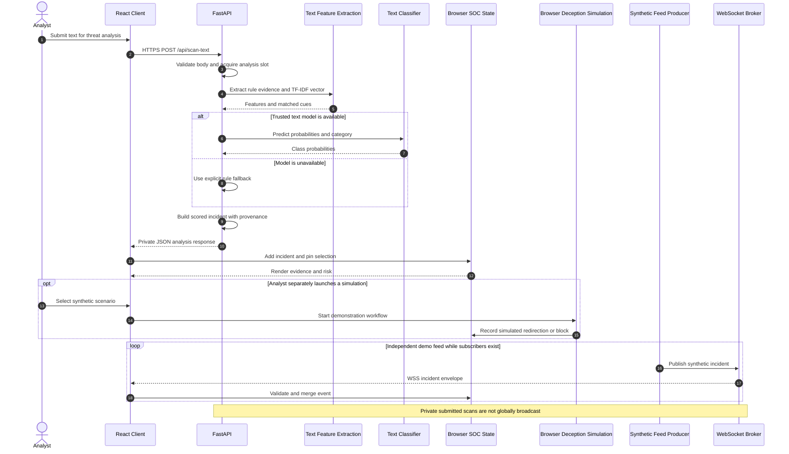
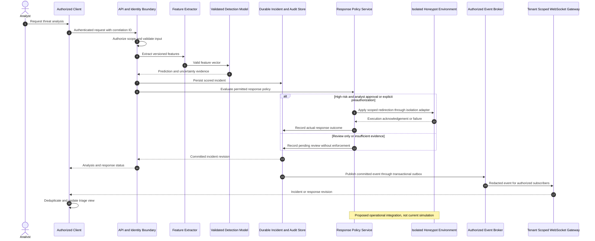
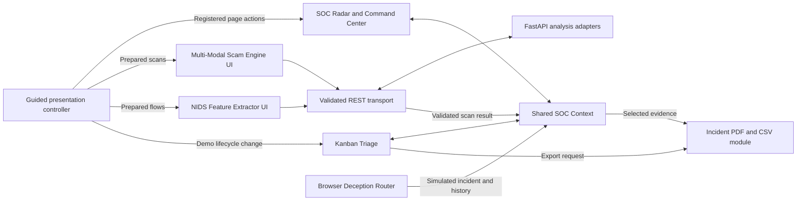

# CHAPTER 4
# SYSTEM ARCHITECTURE AND DESIGN

NeuroShield IDS integrates network-flow inspection, scam analysis, incident investigation, and response demonstrations in a common security operations workspace. Its architecture separates browser presentation, request validation, feature processing, inference, event delivery, and analyst decisions. This separation allows each detection method to evolve without replacing the dashboard or changing the meaning of an investigation record.

This chapter describes the implemented academic prototype and its extension toward an operational intrusion detection platform. The deployed frontend is a React 18 application built with Vite and served through Vercel. A Python FastAPI service hosted on Render provides analysis endpoints and a WebSocket demonstration feed. The text-analysis path uses TF-IDF and logistic regression; the current network and voice paths use transparent rules. Honeypot redirection and endpoint containment are simulated in the browser. Packet capture, an isolated honeypot virtual environment, durable server-side incident storage, and authenticated response automation are proposed extensions and are identified as such throughout the diagrams.

## 4.1 Overall System Architecture

### 4.1.1 Architectural organization

The system follows a decoupled client–server architecture with two communication paths. The request–response path uses HTTPS to submit a specific observation and return its analysis. The event path uses WSS to deliver automatically generated demonstration incidents to connected dashboards. Both paths produce a common incident representation, allowing the interface to display consistent severity, evidence, workflow, and triage controls.

The client is responsible for presentation and analyst interaction. The FastAPI service is responsible for validating submitted observations, coordinating bounded analysis work, and converting results into structured incidents. Detection modules implement modality-specific logic rather than embedding model behavior directly in HTTP handlers. This separation makes it possible to replace a rule engine with a validated classifier while retaining the API contract.

The browser is not a trusted enforcement point. A user can change local application state; consequently, a displayed Contained status demonstrates workflow intent and does not prove that a firewall rule, token revocation, or network isolation action occurred. Operational enforcement requires an authenticated server-side control plane and independent confirmation from the enforcement adapter.

### 4.1.2 High-level block diagram

Figure 4.1 shows the implemented components and the proposed infrastructure extensions. Solid connections represent implemented data exchanges. Dashed connections represent interfaces that require further implementation. The WebSocket layer belongs to the FastAPI service; it is shown separately to explain its responsibility rather than to imply another deployed server.



*Figure 4.1 High-level NeuroShield architecture with implemented and proposed boundaries.*

An ASCII representation of the same separation is useful when the report editor cannot render Mermaid:

```text
                      ANALYST / EVALUATOR
                              |
                   React Client UI on Vercel
                +-------------+--------------+
                |                            |
         HTTPS requests                WSS subscription
                |                            |
       FastAPI REST layer         FastAPI WebSocket layer
                |                            ^
       +--------+---------+          Synthetic demo producer
       |        |         |
      NLP     NIDS     URL / Voice
   TF-IDF +   flow     metadata rules
   classifier rules
       +--------+---------+
                |
         Private REST result
                |
        Browser SOC incident state
                |
       Kanban / evidence / reports
                |
       Browser response simulation

 Proposed operational extension:
 Packet sensor -> flow aggregator -> FastAPI analysis
 Authorized response service -> isolated honeypot VM
 Honeypot telemetry -> durable audit store -> authorized UI
```

### 4.1.3 Client presentation and shared state

On a desktop display, the Command Center divides its content into a monitoring area of approximately 65 percent and a persistent investigation area of approximately 35 percent. The monitoring area presents the threat globe, anomaly charts, event stream, and attack replay controls. The investigation area presents the selected incident, explanatory features, agent-style workflow playback, and response controls. Responsive layouts adapt these panels for smaller screens.

The shared SOC context is the client-side source of truth for incidents and selections. New API results and valid WebSocket events enter this context; individual pages consume the same records rather than maintaining unrelated copies of incident status. Selecting an event pins an investigation by disabling automatic selection of subsequent live events. The store is bounded to the newest 100 records and is persisted in browser session storage where available. This is session persistence, not a multi-user incident database.

The guided presentation controller coordinates page navigation and existing page actions. It provides human-readable pauses, cancellation, manual takeover, and an Executive Q&A state. It is a demonstration orchestrator: it does not introduce an independent detection engine or change the interpretation of model results.

### 4.1.4 Analysis and communication layers

The REST interface exposes the following services:

| Interface | Input and responsibility | Principal output |
|---|---|---|
| `POST /api/scan-url` | HTTP or HTTPS URL; structural, registry-age and TLS checks | Rule score, evidence and incident |
| `POST /api/scan-text` | Message text; language cues and classifier inference | Model-derived risk, category, rule evidence and incident |
| `POST /api/scan-audio` | Spectral metadata and optional transcript | Voice-metadata review index and incident |
| `POST /api/scan-network` | One to 100 numeric flow records | Per-flow analysis and incident records |
| `GET /api/model/evaluation` | Evaluation request | Cross-validation metrics and confusion matrix |
| `GET /api/health` | Health request | Service, model, feed and enforcement availability |
| `WSS /ws/live-feed` | Live subscription and heartbeat messages | Synthetic incident events and connection messages |

The API validates types, bounds and unexpected fields before analysis. HTTP request bodies are limited to 64 KiB. An in-memory limiter permits a bounded number of scan requests per client-address key, and an analysis semaphore limits concurrent work to 12 slots. These controls reduce accidental overload; they do not replace authenticated quotas or protection against distributed denial of service. Client-address interpretation also requires careful proxy configuration in a production deployment.

The WebSocket producer normally emits one synthetic incident every 2.5 seconds. Each connected client receives a bounded queue of 32 events; when a queue is full, its oldest event is discarded before a new event is inserted. The service limits simultaneous WebSocket clients and disconnects stalled senders. The browser sends heartbeat messages and reconnects with bounded exponential backoff. This design supports a responsive demonstration feed but provides neither durable replay nor guaranteed delivery. An in-memory connection manager must be replaced or externalized before using multiple independent workers. [R1]

Private REST submissions are returned only to the requesting client. They are not published to every participant in the shared demonstration feed. This distinction prevents a submitted message or transcript from being broadcast merely because another user has opened the dashboard.

### 4.1.5 Deployment and trust boundaries

Vercel builds the `client/` application and serves `client/dist`. Public API and WebSocket URLs are embedded at build time, using HTTPS and WSS for cloud execution. Render runs the FastAPI service through Uvicorn. The current broker and rate counters are process-local, so the demonstration deployment uses one worker. Model artifacts are loaded from the operator-controlled backend model directory; users cannot upload a pickle or joblib file for execution.

Four boundaries guide the design: the user's browser, the analysis backend, external URL-intelligence services, and the proposed deception environment. Browser data is untrusted input at the backend boundary. External URL metadata is evidence that may be incomplete or unavailable. The proposed honeypot must be isolated from production assets and from the application service that processes ordinary user submissions.

CORS controls which browser origins may make cross-origin requests; it is not authentication or authorization. The demonstration configuration permits broad origin access and disables credentialed CORS. An operational deployment would add identity, roles, tenant-scoped incident access, restricted origins, durable audit records, and response approvals. These are deployment requirements, not claims about controls already present.

## 4.2 Data Flow Diagrams

### 4.2.1 DFD notation and scope

The DFDs describe logical movement of information, not the timing of method calls. Rectangles represent external entities, rounded nodes represent processes, and cylinders represent stores. Each arrow names a data item or record. Processes 1.0–6.0 expand the system in the context diagram. Processes 2.1–2.4 and 3.1–3.6 provide deeper analysis detail. Browser and server placement is described in the prose because a logical DFD may span both execution locations.

The context and Level 1 diagrams describe the current prototype. The packet diagram separately identifies the proposed sensor boundary. The honeypot in Level 1 is a simulation process inside NeuroShield, not an external VM receiving real attack traffic.

### 4.2.2 DFD Level 0 — System context

At Level 0, NeuroShield is one logical process. An analyst submits observations and review commands, then receives findings, demonstration events, and reports. A model maintainer supplies trusted artifacts and receives evaluation results. External DNS, registry and TLS services supply limited URL observations. Packet sensors and virtual honeypots are absent from the implemented external interfaces because they have not yet been integrated.



*Figure 4.2 DFD Level 0 for the implemented NeuroShield prototype.*

### 4.2.3 DFD Level 1 — Major processing functions

Process 1.0 accepts observations and validates their structure. Process 2.0 handles supplied network-flow records. Process 3.0 handles text, URL, audio-metadata and local-file analysis. Process 4.0 presents findings and applies analyst lifecycle decisions. Process 5.0 generates demonstration telemetry and simulates response transitions. Process 6.0 evaluates the text-classification approach using authored examples. Incident records are stored in the browser; trusted model data resides on the backend. The WebSocket queue contains demonstration events and is not an incident database.



*Figure 4.3 DFD Level 1 showing analysis, investigation, simulation and evaluation.*

The external inputs and outputs in Figure 4.2 remain visible in Figure 4.3. The additional stores and process-to-process flows explain the implementation without introducing an unexplained external data source. Evaluation can also be initiated by an evaluator through the Model Performance page; the maintainer role identifies responsibility rather than an enforced account permission.

### 4.2.4 DFD Level 2 — Network and packet-processing path

The present API begins with caller-supplied flow statistics. It does not capture packets, reconstruct TCP sessions, or derive flow counters from a network interface. Accordingly, Figure 4.4 expands the implemented flow-analysis process and shows packet acquisition as a dashed, proposed upstream extension.

```mermaid
flowchart LR
    N["Proposed authorized network sensor"]
    C("Proposed packet capture and bidirectional flow aggregation")
    IN["From 1.0: validated flow records"]
    P21("2.1 Construct canonical numeric feature record")
    P22("2.2 Evaluate four network rules")
    P23("2.3 Compute risk and severity")
    P24("2.4 Assemble evidence and incident")
    OUT["To 4.0: network findings"]
    N -.->|"Packets from an authorized observation point"| C
    C -.->|"Proposed flow input to process 1.0"| IN
    IN -->|"Validated records"| P21
    P21 -->|"Ordered feature values"| P22
    P22 -->|"Matched rules and weights"| P23
    P23 -->|"Score and severity"| P24
    P21 -->|"Original flow evidence"| P24
    P24 -->|"Structured finding"| OUT
```



*Figure 4.4 DFD Level 2 for flow analysis with a proposed packet acquisition extension.*

The processing steps are as follows:

1. **Acquire a record.** An analyst selects an editable fixture, enters flow values, or imports a numeric CSV batch. The browser checks the CSV schema and constructs records with destination port, flow duration, forward packets, reverse packets, byte rate, packet rate, SYN count and ACK count.
2. **Validate the boundary.** FastAPI validates numeric types, finite values, non-negative ranges, destination-port bounds, and a batch limit of 100 records. Invalid data produces a validation response and never reaches scoring.
3. **Construct features.** The implementation uses the submitted statistics directly. Flow duration is expressed in microseconds; byte and packet rates are per second. It does not infer source identity or geolocation from these eight fields.
4. **Evaluate rules.** A packet rate of at least 500/s contributes 40 points. A forward count greater than ten times `max(1, reverse count)` contributes 30 points. A positive SYN count with zero ACK count contributes 20 points. A byte rate of at least 100,000/s contributes 10 points.
5. **Calculate the index.** The network score is `R = 40I1 + 30I2 + 20I3 + 10I4`, where each indicator is one when its rule matches and zero otherwise. The score lies between zero and 100 and is a rule index, not a calibrated probability.
6. **Normalize the finding.** The backend creates an incident with a unique identifier, UTC timestamp, score, severity, explanation and feature list. The prepared SYN-flood fixture matches all four rules and produces 100/100. The normal fixture matches none and produces 0/100. These outcomes validate fixture behavior, not detection accuracy on real traffic.
7. **Present and retain evidence.** The browser adds the returned incident to shared state. The inspector exposes matched rules, and the analyst can change workflow status or export the record.

A future packet collector would observe only an authorized interface or mirror port, timestamp packets, group bidirectional traffic using a defined flow key, handle flow-expiration rules, and calculate the same features before submission. Sensor identity, capture-loss counters, clock synchronization and feature-schema versioning would be required to distinguish real observations from incomplete or synthetic telemetry. Captured payloads should not be forwarded by default when aggregate features are sufficient.

### 4.2.5 DFD Level 2 — Multimodal text and audio analysis

Multimodal operation means that the workspace accepts several evidence types. It does not imply that a single trained model jointly fuses audio, text and images. The implemented paths retain separate evidence provenance and scoring semantics.



*Figure 4.5 DFD Level 2 for text, voice metadata, URL and browser-local file analysis.*

**Text processing flow.** The client submits the message to `/api/scan-text`. The backend identifies urgency, authority, coercion, payment, credential and secrecy cues using transparent language rules. Separately, the fitted TF-IDF vectorizer converts the text to a sparse feature vector. The logistic-regression classifier returns class probabilities and a predicted class. The displayed model-derived risk is the rounded value of `100 × (1 − P(Safe | text))`. This is an uncalibrated aggregate non-Safe estimate, even though the API field is named `smishingProbability`; it is not an independently validated probability of smishing alone. If model loading fails, the service explicitly falls back to the bounded language-rule score.

The visible feature bars represent matched rule contributions. They do not decompose the classifier probability and should not be expected to sum to the model-derived score. No implemented SHAP or LIME computation is implied by the XAI interface. This separation lets an evaluator distinguish a predictive output from human-readable supporting cues.

**Voice-metadata processing flow.** `/api/scan-audio` receives JSON metadata rather than an uploaded waveform. It validates spectral centroid, spectral flatness, pitch variance, duration and optional transcript. Low supplied pitch variance contributes 25 points; high supplied spectral flatness contributes 25; high supplied spectral centroid contributes 15; sufficiently strong transcript persuasion cues contribute 30. The result is a heuristic review index. The endpoint returns no trained synthetic-voice likelihood because a validated voice classifier is not installed.

**Local recording flow.** The file scanner separately decodes supported audio in the browser, combines channels, calculates signal descriptors including mean MFCC values, and displays a waveform with playback controls. Recordings are limited to 60 seconds and 15 MB. These measurements are local inspection output. The current synthetic-vishing REST scenario sends fixed demonstration metadata and a prepared transcript; it does not silently upload the locally selected recording or transcribe it. A proposed production integration would explicitly connect validated local descriptors or an authorized upload to a trained voice model, with user consent and an evidence-source label.

**Visual and URL flow.** QR decoding and receipt OCR run locally and reveal extracted text or URL candidates. Extraction alone does not establish authenticity or prove that a payment occurred. URL inspection parses the hostname, checks brand resemblance and credential-themed terms, and attempts constrained public TLS and registry checks. Private or unresolved destinations are not inspected, registry-age support is limited to `.com` and `.net`, and destination page bodies or redirects are not fetched. An unavailable observation remains unknown rather than being converted into a safe result.

## 4.3 Sequence Diagram

### 4.3.1 Implemented analysis and independent live-feed sequence

The implemented sequence separates a user's private analysis result from shared synthetic telemetry. Figure 4.6 uses text analysis to show feature extraction and classifier inference. Network and voice requests follow the same API response pattern but invoke their rule modules instead. Browser response simulation occurs only through demonstration or analyst controls; it is not an automatic backend effect of every scan.



*Figure 4.6 Implemented sequence for private analysis and independent demonstration telemetry.*

Step-by-step, the client first freezes the submitted value for a request, marks the interface busy, and creates an abortable operation. FastAPI rejects invalid or excessive input before invoking analysis. The text engine extracts its features and invokes the trusted classifier when available. The response includes both analysis and the normalized incident, enabling the client to update the evidence view without another query. The browser checks the response contract before merging it into shared state. Separately, incoming WebSocket events update the live monitoring views. A pinned investigation remains stable while other events arrive.

Validation failures, capacity rejection, lookup timeout and unavailable services must remain visible as failures. They must not produce a fabricated low-risk result. The presentation controller pauses on failed tour-owned analysis and lets the presenter retry or skip. Cancelling a request stops the client from applying its result; it does not guarantee that an already-running server computation was terminated.

### 4.3.2 Proposed operational sequence with honeypot routing and broadcast

Figure 4.7 describes the requested end-to-end operational sequence: client request, feature extraction, model inference, honeypot routing and WebSocket notification. This is a target design. It requires a server-side response service, authenticated event subscriptions, durable storage, and an isolated honeypot environment that are not part of the present demonstration deployment.



*Figure 4.7 Proposed authenticated analysis-to-honeypot sequence.*

The response service evaluates policy only after an incident has been recorded. High risk is an input to a decision, not sufficient permission to redirect traffic. A scoped adapter should apply an approved action and return an execution result. Failed routing leaves the incident in a review or failure state; a successful acknowledgement supports a confirmed response state. Writing an outbox event with the incident revision prevents notification from becoming disconnected from persisted evidence. Subscribers receive only incidents they are authorized to inspect, with duplicate event identifiers handled idempotently.

### 4.3.3 Incident contract and lifecycle

The common record connects these interactions. Its principal fields are:

| Field group | Design purpose |
|---|---|
| `id`, `timestamp`, `source`, `signalType` | Identify the observation and its origin |
| `score`, `severity`, `title` | Present a bounded risk summary and category |
| `features`, `explanation`, `payload` | Retain evidence and the explanation presented to the analyst |
| `demo`, `provenance` | Distinguish simulation, heuristic analysis and model-based analysis |
| `status`, `phase`, `autoManaged` | Separate triage status from demonstration execution phase |
| `history` | Record timestamped review and simulated-response actions |

The current severity mapping is Critical at 85 or above, High at 65–84, Medium at 35–64, Low above zero and below 35, and Safe at zero. A Safe label therefore means that the configured scoring path returned zero; it does not certify the observation as benign. Different score sources retain different meanings and must not be averaged into a calibrated probability without a validated fusion method.

Triage supports Open, Triaged, In Progress, Resolved and Contained. A manual status change disables automatic management for that incident. The simulation logic preserves this analyst decision rather than overwriting it with a later scheduled containment transition. The current history is useful for presentation and reconstruction but is not immutable, independently authenticated audit evidence.

## 4.4 Component and Module Design

### 4.4.1 SOC Radar and Command Center

The SOC Radar module translates shared incident state into monitoring views. Its inputs are incident records, the selected incident identifier, replay progress, and connection status. React Three Fiber and Three.js display the globe and signal paths; Recharts presents anomaly and risk views. Colors encode severity, while the inspector gives the exact score, evidence source and explanation. The globe is an illustrative topology, not a measured network map or verified geolocation system.

WebSocket events are schema-checked before entering the store. A bounded record list prevents indefinitely growing browser memory. A user can pause the feed, filter the event stream, select an investigation, and replay its demonstration phases. Automatic follow mode selects new arrivals; pinning turns that behavior off so the presenter can discuss one record. Where WebGL is unavailable, the event stream remains the accessible means of selecting evidence.

The four-stage agent display represents signal decoding, vector analysis, scoring and response playback. Its animation is not evidence that an autonomous agent performed those operations in real time. The guided presentation module invokes actual scan handlers where available and otherwise uses explicitly labeled synthetic scenarios. This preserves the distinction between an explanatory visualization and measured backend work.

### 4.4.2 Multi-Modal Scam Engine

The Scam Engine combines modality-specific adapters under a consistent result contract. Text analysis invokes the backend model and supplies independently computed language cues. URL analysis provides structural and bounded external observations. Voice scenarios submit spectral metadata and a transcript for rule inspection. File analysis displays local waveform descriptors, QR content and OCR output without presenting extraction as proof of fraud.

The module interface accepts a signal kind, value, demonstration flag and cancellation signal. Transport errors are translated into visible analysis failures. The response parser requires the incident and evidence arrays before updating shared state. The UI exposes editable prepared examples, allowing an evaluator to modify a suspicious phrase or hostname and rerun analysis rather than treating the demonstration as a fixed animation.

The model-loading boundary is intentionally separate from the user-input boundary. Only trusted repository-installed artifacts are deserialized. A future replacement model should document its label taxonomy, training corpus, feature version, probability calibration, evaluation split and limitations. A text or voice score should not be described as real-world accuracy merely because the interface can display a percentage.

### 4.4.3 NIDS Feature Extractor and Risk Pipeline

The current NIDS feature module supplies input definitions, prepared fixtures, CSV parsing and canonical numeric fields. It rejects missing or duplicate columns and malformed numeric records before submission, while the backend repeats authoritative validation. This repetition is deliberate: browser checks improve usability, whereas server checks enforce the API contract.

The analysis function is deterministic for a given flow record. It emits the matching rule names and point contributions alongside the resulting risk. Determinism makes the SYN-flood versus baseline comparison reproducible during evaluation and permits precise unit and API tests. It also makes the limitation visible: four rules cannot establish general intrusion-detection performance, identify every attack family, or replace a validated network classifier.

A proposed trained NIDS adapter would consume an explicitly versioned feature schema and the exact preprocessing transformation used during training. Feature ordering, units, missing-value handling and scaling must match the trained artifact. Introducing a model trained on a different dataset requires a documented schema mapping; substituting eight UI fields for an unrelated trained model's required features would not be valid integration.

### 4.4.4 Deception Router and Honeypot Virtual Environment

The implemented Deception Router creates a synthetic incident and schedules its demonstration phases. With the honeypot toggle enabled, a terminal phase records simulated redirection; otherwise it records a simulated block. These transitions update the browser investigation history. No routing table, firewall, virtualization host or remote endpoint is modified.

An operational Honeypot Virtual Environment is proposed as a separate, disposable VM or isolated workload hosting controlled decoy services. Its management interface should not be reachable from the decoy network. Egress should be denied by default, production credentials and writable shared production storage should be excluded, and resource limits should prevent a decoy from exhausting the application host. Telemetry should leave through a narrow collection channel, with snapshots or rebuilds used to reset the environment after an exercise.

The proposed router would accept an incident identifier, approved action, target scope and expiry rather than an arbitrary shell command. It would enforce analyst permissions, allowlisted targets, idempotent action identifiers and rollback instructions. Its output would distinguish requested, pending, succeeded, failed and reverted actions. This prevents a visual status update from being mistaken for confirmed enforcement.

### 4.4.5 Kanban Triage and Incident Reporting

Kanban Triage provides the analyst-facing lifecycle of an investigation. The current page offers a paginated list, search, severity and status filters, a five-column board, a selected-record status control, and a persistent inspector. Dragging a card or changing its status updates the same shared record. The list is the compact default; the board offers independently scrollable columns for larger collections.

An incident remains identifiable across pages by its identifier. Repeated WebSocket arrivals with the same identifier are merged rather than appended as independent records. Manual status updates append timestamped history and suppress later automated simulation decisions for that record. The guided containment demonstration selects a flagged synthetic finding so it does not overwrite a user's submitted evidence.

The report module produces an IEEE-style incident PDF containing selected evidence, a SHA-256 digest over defined incident fields, timestamps and response history. IEEE-style refers to report layout, not IEEE certification or publication. The digest supports comparison of the included field representation; it is not a digital signature, and it does not by itself authenticate the origin, cover every exported history field, or establish legal chain of custody. A production evidence service would require access-controlled durable records and tamper-evident audit storage.

### 4.4.6 Module dependency diagram



*Figure 4.8 Component dependencies and shared-state integration.*

| Module | Principal implementation location | Responsibility boundary |
|---|---|---|
| Dashboard and radar | `client/src/pages/Dashboard.jsx`, `components/dashboard/ThreatGlobe.jsx` | Visualization and investigation selection |
| Shared incident state | `client/src/enterprise/SocContext.tsx`, `domain.ts` | Incident merge, selection, session storage and lifecycle |
| Scam analysis | `client/src/enterprise/ScamLabPage.tsx`, `backend/analysis.py` | Prepared inputs, model or rule analysis and evidence |
| Local multimodal inspection | `client/src/components/dashboard/MultiModalScanner.jsx` | Browser-local audio descriptors, QR decoding and OCR |
| Network analysis | `client/src/pages/NetworkIntrusion.jsx`, `enterprise/networkInputs.js`, `backend/research.py` | Flow schema, input preparation and rule scoring |
| Deception simulation | `client/src/enterprise/SimulatorPage.tsx`, `SocContext.tsx`, `domain.ts` | Synthetic scenarios and simulated terminal phases |
| Kanban and reports | `client/src/enterprise/IncidentsPage.tsx`, `IncidentInspector.tsx`, `components/dashboard/incidentReport.js` | Triage, investigation and export |
| Backend and live events | `backend/main.py` | Validation, REST routing, lifecycle and WebSocket broker |
| Guided presentation | `client/src/enterprise/GuidedTour.jsx`, `tourPlan.js` | Cancellable seven-step demonstration orchestration |

### 4.4.7 Verification and design rationale

Verification follows the same boundaries as the architecture. Input tests exercise numeric schema errors, excessive payloads and invalid URLs. Analysis tests verify deterministic rules and valid incident contracts. Transport tests exercise WebSocket connection behavior and preserve separation between private scans and shared demonstration events. UI checks cover shared selection, lifecycle changes, filtering, PDF generation and tour cancellation. Performance observations should identify whether they measure backend inference, network transport, or event-receipt-to-React-commit time; these quantities are not interchangeable.

Model evaluation uses two stratified folds over the original project-authored text examples. Each fold fits its own TF-IDF transformation and classifier before predicting withheld examples. Keeping preprocessing inside the cross-validation pipeline prevents the vocabulary from being learned on the held-out fold. [R2] The resulting accuracy, macro precision, macro recall, macro F1 and confusion matrix describe this educational experiment. They do not establish performance on UNSW-NB15, NSL-KDD, CICIDS2017, or an independent voice-deepfake benchmark.

The architecture supports incremental development: an authenticated durable incident service can replace browser-only persistence; a versioned sensor adapter can supply measured network flows; a validated voice model can replace metadata heuristics; and an isolated response service can replace simulated enforcement. Each extension should preserve explicit provenance and the distinction between observation, prediction, analyst decision and confirmed response.

### References for architectural conventions

[R1] FastAPI, “WebSockets.” The connection-manager example explains the limitation of in-memory state to one running process. https://fastapi.tiangolo.com/advanced/websockets/

[R2] scikit-learn, “Cross-validation: evaluating estimator performance.” Pipeline-based preprocessing and evaluation methodology. https://scikit-learn.org/stable/modules/cross_validation.html

[R3] Mermaid, “Sequence diagrams” and “Diagram syntax.” Diagram-code notation used in Figures 4.1–4.8. https://mermaid.js.org/syntax/sequenceDiagram and https://mermaid.js.org/intro/syntax-reference.html

Implementation details in this chapter are grounded in the NeuroShield source modules identified in Section 4.4.6. Dashed architecture connections and Figure 4.7 describe proposed extensions rather than implemented services.
